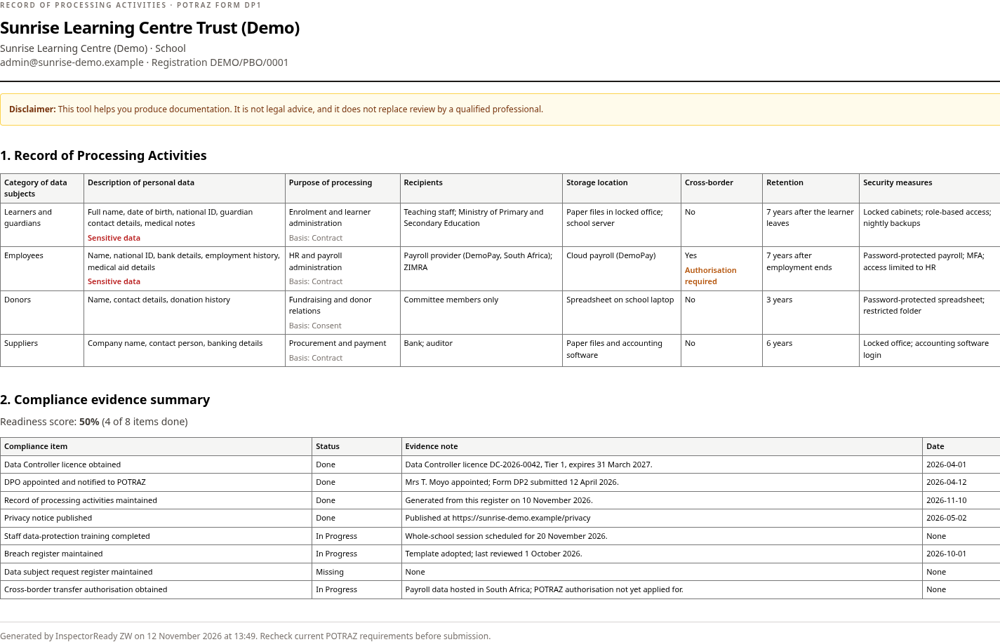

# InspectorReady ZW

InspectorReady ZW turns plain-English answers about your organisation's personal data into a printable Record of Processing Activities (ROPA) and an eight-item compliance evidence pack. It is built for Zimbabwean organisations preparing for POTRAZ data-protection inspections under the Cyber and Data Protection Act [Chapter 12:07] (2021).

> This tool helps you produce documentation. It is not legal advice. A qualified professional should review it.


## What it does

1. Sign up. One account per organisation, with the entity details an inspection asks for.
2. Record processing activities. Whose data you hold, what the data is, why you hold it, your lawful basis, recipients, storage, retention and security measures.
3. Flag risk. Sensitive data and cross-border transfers are marked in the register and in the export.
4. Track the eight compliance items an inspector asks to see. Licence, DPO, ROPA, privacy notice, staff training, breach register, data subject request register and cross-border authorisation.
5. Print the pack. The browser prints a ROPA table and an evidence summary.

## Demo

- Live: <https://inspectorready-zw.onrender.com>
- Email: `demo@inspectorready.co.zw`
- Password: `DemoPass123!`

The demo account is read-only. Every organisation, person and detail in the demo data is fictional.

## Stack

Node.js 24, Express 5, EJS, PostgreSQL on Neon with raw SQL (no ORM), `cookie-session` and `bcryptjs`. Deployed on Render. Five runtime dependencies. No React, no build step, no PDF library.

Why these choices:

- `cookie-session` instead of a sessions table. Fewer parts to break. The session is signed, `httpOnly`, `sameSite=lax`, and `secure` in production.
- `bcryptjs` instead of native `bcrypt`. No native build step, so deploys cannot fail on compilation. Cost factor 12.
- Raw SQL with `pg`. Small, parameterised queries. No ORM to configure or upgrade.
- Browser print instead of a PDF library. `public/print.css` handles A4 landscape, page breaks and hidden navigation.

## Database

`schema.sql` is the source of truth. It creates four tables: `orgs`, `users`, `processing_activities`, `compliance_items`.

`seed.sql` loads the fictional demo organisation. It deletes and recreates only the demo org, so re-running it is safe.

Every query is parameterised and every read and write is scoped by the `org_id` from the session cookie. One organisation cannot see or change another organisation's records.

## Security

- bcrypt password hashing at cost factor 12, with a dummy-hash comparison when the email does not exist.
- CSRF token on every state-changing form, checked with `timingSafeEqual`.
- Login limited to 10 failed attempts per IP per 15 minutes.
- Demo sessions are read-only. Writes are rejected on the server. The UI hides the controls too.
- Response headers: `X-Content-Type-Options`, `X-Frame-Options: DENY`, `Referrer-Policy`.
- EJS escapes output by default. Secrets live in environment variables; `.env` is gitignored.

## Run locally

```bash
cp .env.example .env   # add your Neon DATABASE_URL and a SESSION_SECRET
npm install
npm run db:setup
npm run db:seed
npm test
npm run dev
```

Open http://localhost:3000.

`DATABASE_URL` is the Neon connection string. `src/db-url.js` strips `sslmode` and `channel_binding`, then enables TLS explicitly, because `node-postgres` does not implement `channel_binding`.

## Deploy on Render

1. Create a Web Service from this repository.
2. Build command: `npm install`
3. Start command: `npm start`
4. Health check path: `/health`
5. Environment variables:
   - `DATABASE_URL` (Neon connection string)
   - `SESSION_SECRET` (long random string)
   - `NODE_ENV` (`production`)
6. Run `schema.sql` and `seed.sql` once against the Neon database.

## Print / PDF

Open **Export** and choose **Print / Save as PDF**. The print stylesheet uses A4 landscape, repeats table headers, avoids breaking rows across pages and hides the site navigation.



## Licence

MIT
